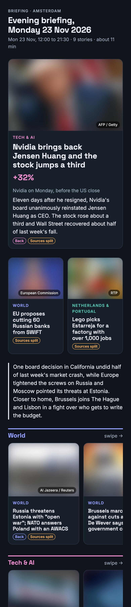
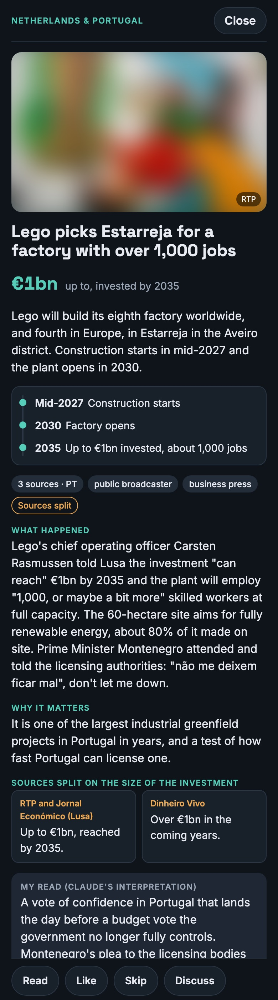
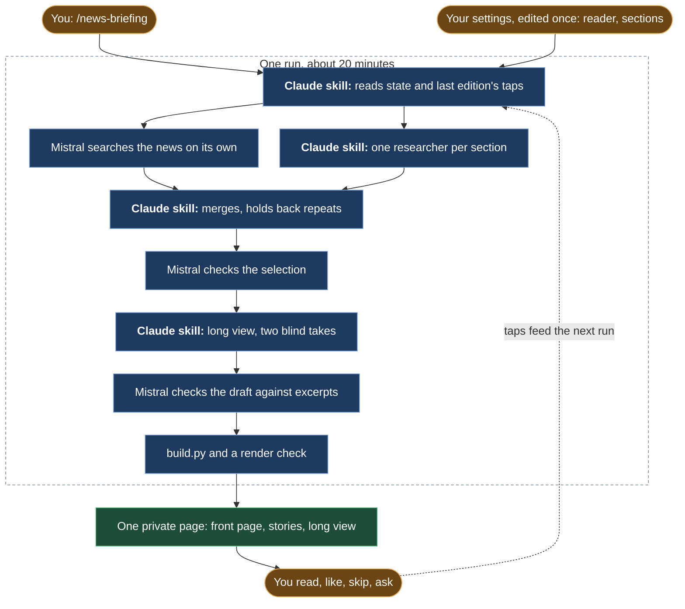

# news-briefing-skill

A Claude Code skill that builds a personal news briefing as one private page for your phone. Mistral checks what Claude picks and writes, a topic covered this week stays out unless something real changed, and your taps on the page decide what gets more room next time.

## Preview

<p>



</p>

The 23 Nov 2026 evening edition at phone width: the front page, an opened story, and the long view. Press photos are blurred here; on your own page they show as the outlet published them, with the credit. The edition file is in [`examples/`](examples/2026-11-23.json).

## What it does




1. **Read state.** The settings, your notes, the last edition, and every tap saved on the page since then. `tally.py` turns the taps into two tables: what the stories were about (tags) and what kind of story they were (angles).
2. **Research.** One Claude subagent per section searches and reads the pages in parallel, about 25 candidates in all. A fact goes on the page only from a page read in that run; a story known only from a headline or a digest says so.
3. **Mistral, blind.** Mistral searches the news on its own before it sees Claude's list, so its picks are not anchored on Claude's. Stories only Mistral found are checked against a second source.
4. **Merge.** A topic covered in the last seven days is held back unless something significant changed: a deal signed or collapsed, a vote, a ruling, a resignation. Engaged tags get fuller treatment; skipped ones shrink to a one-line brief, but a major story always runs.
5. **Selection and draft checks.** Mistral drops, ranks and flags. Claude follows it where its reason holds and overrules it where it does not, and records both. A flag counts only if it cites a source excerpt.
6. **The long view.** One analysis piece per edition. Claude and Mistral each answer the same question blind from the same evidence pack, then reply once. The page shows Claude's argument, Mistral's position in its own words, and one call that could turn out wrong, with a date.
7. **Build and publish.** `build.py` turns the edition file into the page, with the press photos shrunk and stored beside it; `check_render.js` opens every story in a stand-in browser before anything is published to the fixed private link.

**Constraints:** nothing about you is in the skill. Your reader line, sections and Mistral setup live in `settings.md`; what the briefing learns lives in `state/preferences.md`, which you can edit, and your own notes there win over the counts. Only public news text and the reader line go to Mistral; never your taps, questions or preferences.

## Why this exists

I follow four beats: the world, the Netherlands (where I live), Portugal (where I am from) and AI. A news briefing in a chat window gave me a long list, repeated yesterday's stories, and had no idea what I had actually read. I wanted one page on my phone that reads like a front page and shows where trusted sources disagree. Mistral argues with Claude's choices, and the page learns from what I open, like, skip and ask about.

## Requirements

- Claude Code with skills enabled, signed in to a claude.ai account that can publish Artifacts. The page uses two Artifact capabilities: saved data (your taps) and Claude chat (the Discuss box under each story).
- Python 3.12 or later. The scripts use the standard library only. On macOS, `sips` shrinks the photos; elsewhere they are kept as served.
- Node.js, for the render check that runs before every publish.
- Mistral, through its Vibe CLI with web search, as the second editor. Any other model you can call from the shell can take its place; with none set, the skill runs on Claude alone and the page says so.
- [uv](https://docs.astral.sh/uv/) to run the tests.

## Install

The page can only be published from files inside the folder Claude Code is working in, so the skill goes into a project folder of its own:

```bash
git clone https://github.com/nunomnferreirapt/news-briefing-skill.git
mkdir -p ~/news-briefing/.claude/skills
cp -R news-briefing-skill/skill/news-briefing ~/news-briefing/.claude/skills/
```

Then edit `~/news-briefing/.claude/skills/news-briefing/settings.md` once: the reader line, your sections, the optional local section, and the command that calls Mistral. Swap the country blocks in `sources.md` for your own.

To run the tests: `cd news-briefing-skill && uv sync && uv run pytest`.

## Usage

Open Claude Code in `~/news-briefing` and type `/news-briefing`. The first run publishes the page and writes its link into `state/CURRENT.md`; every later run updates the same link. Open it on your phone, tap Read, Like or Skip on what you read, ask questions under a story, and pick the next long-view question if you want to. The next run reads all of it.

## How the page learns from your taps


Every tap is saved on the page. At the start of each run, `tally.py` rebuilds every standing from scratch:

- **Engaged:** the latest story was read for 30 seconds or more, liked or discussed. Full cards and first claim on borderline slots.
- **Cooling:** passed over once. Shorter cards.
- **Skipped:** a Skip, or passed over twice. One-line briefs.

Only the last three stories count, so one read brings a tag back. An edition you never opened counts for nothing. A Discuss message like "less of the polls" is a request for the next run. Your notes in `preferences.md` overrule the counts, and the day's major stories run regardless.

## Repository layout

```
skill/news-briefing/
  SKILL.md            the steps Claude follows
  settings.md         reader, sections, local section, Mistral
  sources.md          outlets by kind, country, lean and access
  prompts/            the five prompts for Mistral
  page/               template.html, the page; SCHEMA.md, the edition format
  build.py            edition file to page plus photos
  check_render.js     opens every story in a stand-in browser before publishing
  tally.py            taps to the Tags and Angles tables, and the covered list
  state/              preferences.md and CURRENT.md, empty until the first run
examples/             the 23 Nov 2026 edition and the images in this README
tests/                pytest for build and tally, no network
```

## License

MIT, see `LICENSE`.

Built by [Nuno Ferreira](https://www.linkedin.com/in/nunomnferreira).
