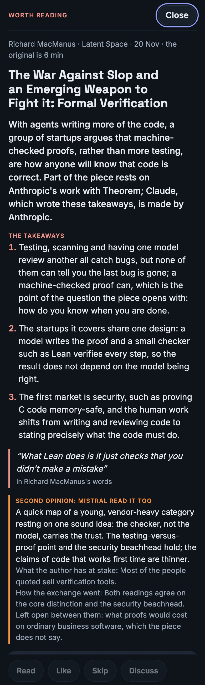
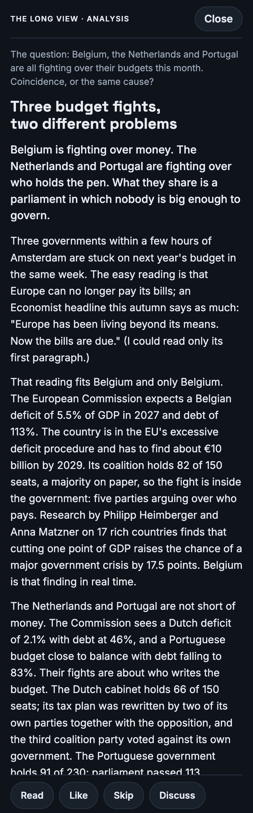
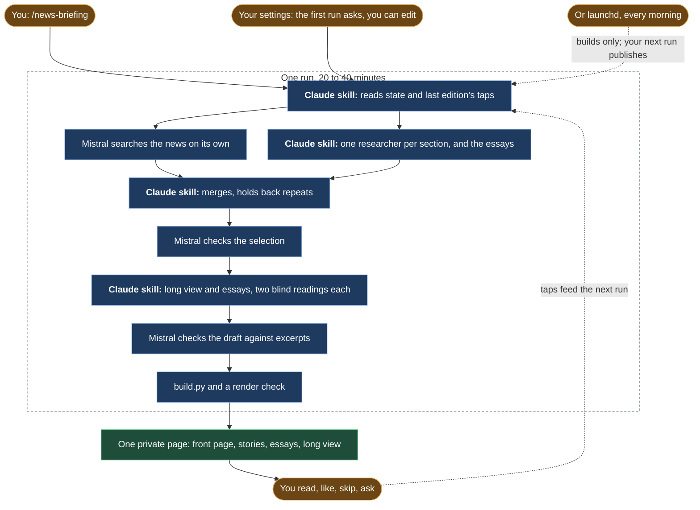
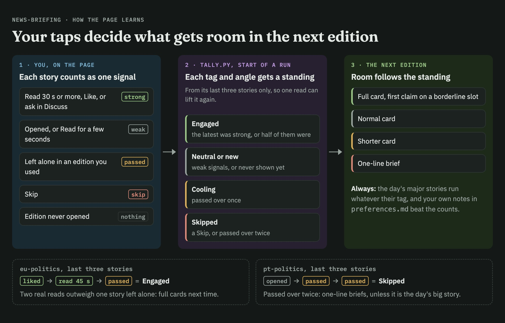

# news-briefing-skill

A Claude Code skill that builds a personal news briefing as one private page for your phone. A topic covered this week stays out unless something real changed, a few essays you choose come back as takeaways, and your taps on the page decide what gets more room next time. Mistral, or any model you can call from the shell, can check what Claude picks and writes. It runs when you ask, or every morning on its own.

## Preview

<p>




</p>

The 23 Nov 2026 evening edition at phone width: the front page, an opened story with Claude's "So what" under the summary, an essay from Worth reading, and the long view. Press photos are blurred here; on your own page they show as the outlet published them, with the credit. The edition file is in [`examples/`](examples/2026-11-23.json).

## What it does




1. **Read state.** The settings, your notes, the last edition, and every tap saved on the page since then. On the very first run it asks you who you are, which beats and countries to follow, and whether you have a second model, and writes the settings for you. `tally.py` turns the taps into two tables: what the stories were about (tags) and what kind of story they were (angles).
2. **Research.** One Claude subagent per section searches and reads the pages in parallel, about 25 candidates in all. A fact goes on the page only from a page read in that run; a story known only from a headline or a digest says so. Every story gets a photo from a page that was read, never a generated one.
3. **Mistral, blind.** Mistral searches the news on its own before it sees Claude's list, so its picks are not anchored on Claude's. Stories only Mistral found are checked against a second source.
4. **Merge.** A topic covered in the last seven days is held back unless something significant changed: a deal signed or collapsed, a vote, a ruling, a resignation. Engaged tags get fuller treatment; skipped ones shrink to a one-line brief, but a major story always runs.
5. **Selection and draft checks.** Mistral drops, ranks and flags. Claude follows it where its reason holds and overrules it where it does not, and records both. A flag counts only if it cites a source excerpt. Each story leads with "So what": Claude's position on what it changes and what would prove it wrong, kept apart from the facts below it.
6. **Worth reading.** One to three new essays from writers you chose, each read whole and boiled down to a few takeaways, a quote checked word for word, and the case where you should open the original. Claude and Mistral each read the essay blind, then compare notes; Mistral's view stays on the page in its own words.
7. **The long view.** One analysis piece per edition. Claude and Mistral each answer the same question blind from the same evidence pack, then reply once. The page shows Claude's argument, Mistral's position in its own words, and one call that could turn out wrong, with a date.
8. **Build and publish.** `build.py` turns the edition file into the page, with the press photos shrunk and stored beside it; `check_render.js` opens every story in a stand-in browser before anything is published to the fixed private link.

**Constraints:** nothing about you is in the skill. Your reader line, sections, writers and second model live in `settings.md` and `sources.md`; what the briefing learns lives in `state/preferences.md`, which you can edit, and your own notes there win over the counts. Only public news text, essay text and the reader line go to the second model; never your taps, questions, preferences or job search. Without a second model, every step runs on Claude alone and the page says so.

## Why this exists

I follow four beats: the world, the Netherlands (where I live), Portugal (where I am from) and AI. A news briefing in a chat window gave me a long list, repeated yesterday's stories, and had no idea what I had actually read. I wanted one page on my phone that reads like a front page and shows where trusted sources disagree. Mistral argues with Claude's choices, and the page learns from what I open, like, skip and ask about.

## Requirements

- Claude Code with skills, signed in to a claude.ai account that can publish Artifacts. The page uses two Artifact capabilities: saved data (your taps) and Claude chat (the Discuss box under each story).
- Python 3.12 or later and Node.js on the PATH (`python3 --version`, `node --version`). The scripts use the standard library only; Node runs the render check before every publish. On macOS, `sips` shrinks the photos; elsewhere they are kept as served.
- Optional: a second model you can call from the shell. Mistral through its Vibe CLI is the worked example in `settings.md`; Codex, Gemini or a local Ollama model work the same way.
- Optional, for the nightly run: macOS.
- [uv](https://docs.astral.sh/uv/), only to run the tests.

## Install

```bash
git clone https://github.com/nunomnferreirapt/news-briefing-skill.git
cd news-briefing-skill
./install.sh                 # into ~/news-briefing; or ./install.sh ~/some/other/folder
```

`install.sh` only copies files: the steps into `~/news-briefing/.claude/skills/news-briefing/`, and the scripts, prompts, page and your settings into `~/news-briefing/news-briefing/`. No sudo, no global packages. It warns if `claude`, `python3` or `node` is missing.

The page can only be published from files inside the folder Claude Code is working in, so the briefing lives in a project folder of its own.

## Usage

```bash
cd ~/news-briefing
claude
```

Then type `/news-briefing`.

- **First run.** It asks a handful of questions: who you are in one line, your beats, your countries, an optional local scene, whether you are job hunting, which essay writers, and an optional second model. Then it writes `settings.md`, trims `sources.md` to your countries, and makes the first edition. It publishes one private page and writes its link into `news-briefing/state/CURRENT.md`.
- **Every later run** updates the same link. Open it on your phone, tap Read, Like or Skip, ask questions under a story, and pick the next long-view question if you want to. The next run reads all of it.
- **Settings** stay yours: edit `news-briefing/settings.md` and `news-briefing/sources.md` at any time. To add or drop an essay writer, edit the Worth reading table in `sources.md`.

## Optional parts

- **A local section.** One scene you follow closely, such as a city's startup scene: funding rounds, offices opening, senior hires, rankings, and events in the next five weeks.
- **Job search.** Fill in `seeking` in `settings.md` and each local story gets a "For your search" note, with only what the sources support. Essays about the job market move to a "Career reading" block, and companies on your watch list are marked. None of it is ever sent to the second model.
- **Worth reading** can be switched off in `settings.md`.

## The nightly run (macOS)

The briefing can build itself every morning, so it is ready when you wake up:

```bash
cd ~/news-briefing
zsh news-briefing/nightly/install.sh
```

Run it from a terminal where `claude` works: it saves that terminal's PATH into the job, because launchd starts jobs with almost no PATH. It writes one file, `~/Library/LaunchAgents/local.news-briefing.<folder>.plist`, and loads it. The time comes from `nightly:` in `settings.md` (06:00 by default). It prints how to check the job and how to run it now.

What to expect:
- **It builds but does not publish.** A run that launchd starts gets no page tools, so it stops after the render check. The next time you type `/news-briefing`, the night's build is published first and your taps are saved for the next night; `/news-briefing publish` does only that. If you skip a morning, the next night's build replaces it: only the newest is ever published.
- **It is fenced in.** It reads the open web with nobody watching, so it may write only in `news-briefing/state/` and `news-briefing/out/`, never your settings, the scripts or the page it runs later. It may run the three scripts and the second-model wrapper; everything else is refused without asking. It never commits or pushes.
- **It skips** until the first run has done the setup, when today's edition already exists, or when another run is still going.
- **It leaves a trace.** The full log is `news-briefing/out/nightly.log`. A night that failed or skipped adds one line to `news-briefing/state/nightly-runs.md`, and your next run tells you about it. Taps from the page reach the night run one edition late.
- **Cost:** a full edition every day, with four research agents, plus the second model's calls if you set one.

Remove it with `zsh news-briefing/nightly/uninstall.sh`.

## Update and uninstall

- **Update:** `git pull` in the clone, then `./install.sh` again. It replaces the steps, scripts, prompts and page, and keeps `settings.md`, `sources.md` and everything in `state/`.
- **Uninstall:** run `nightly/uninstall.sh` if you installed the nightly run, then delete `~/news-briefing`. The page stays in your claude.ai account until you delete it there.

## How the page learns from your taps



Every tap is saved on the page. At the start of each run, `tally.py` rebuilds every standing from scratch, for stories and essays alike:

- **Engaged:** the latest story was read for 30 seconds or more, liked or discussed. Full cards and first claim on borderline slots.
- **Cooling:** passed over once. Shorter cards.
- **Skipped:** a Skip, or passed over twice. One-line briefs.

Only the last three stories count, so one read brings a tag back. An edition you never opened counts for nothing. A Discuss message like "less of the polls" is a request for the next run. Your notes in `preferences.md` overrule the counts, and the day's major stories run regardless.

## Repository layout

```
install.sh              copies skill/ into your project folder; on an update, keeps your files
skill/                  what lands in the project folder
  .claude/skills/news-briefing/
    SKILL.md            the steps Claude follows
  news-briefing/
    settings.md         setup marker, reader, sections, local section, job search, second model, nightly time
    sources.md          outlets by kind, country, lean and access; the Worth reading writers
    prompts/            the eight prompts for the second model
    page/               template.html, the page; SCHEMA.md, the edition format
    build.py            edition file to page plus photos
    check_render.js     opens every story and essay in a stand-in browser before publishing
    tally.py            taps to the Tags and Angles tables, the covered list, the essays already shown
    second.sh           runs the second model's command from settings.md, in a folder of its own
    nightly/            run_nightly.sh, install.sh and uninstall.sh for launchd
    state/              preferences.md and CURRENT.md, empty until the first run
examples/               the 23 Nov 2026 edition and the images in this README
tests/                  pytest for build and tally, no network
```

To run the tests: `uv sync && uv run pytest`.

## License

MIT, see `LICENSE`.

Built by [Nuno Ferreira](https://www.linkedin.com/in/nunomnferreira).
